# Building Age Classifier

Predicting the age of buildings in Madrid and Amsterdam from 40 years of Landsat satellite data.


Our objective for this was to explore and learn the fundamentals of data analysis and machine learning by building a model that can tell how old the buildings in a 30 m patch of city are, using only satellite images. We trained the model on Madrid and then moved it to Amsterdam using only a small number of labelled examples. The project was done as Group 3 at the StatsGeeks × Hack4Dev hackathon in September 2026.

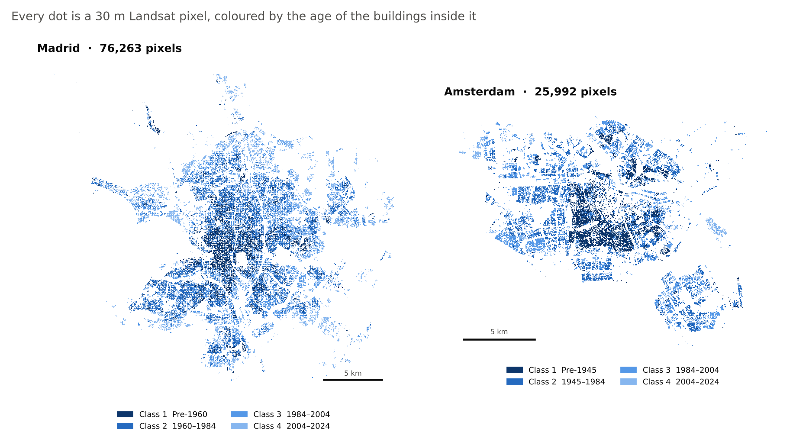

| Score (macro F1) | Provided baseline | Our checkpoint | Final |
|---|---:|---:|---:|
| Madrid, 10-fold spatially blocked CV | 0.6179 | 0.6849 | **0.6976 ± 0.0108** |
| Amsterdam, no labels (zero-shot) | 0.3427 | 0.4787 | **0.5192** |
| Amsterdam, 25 labels per class | 0.5986 | 0.6340 | **0.6499 ± 0.0109** |

**Terms used in this README**

- <sub><i><b>Pixel:</b> one 30 m × 30 m square of the satellite image. Each pixel is one row in our final dataset.</i></sub>
- <sub><i><b>Macro F1:</b> a score from 0 to 1. It balances how many pixels we got right with how many we missed, then averages over the four classes so small classes count as much as big ones.</i></sub>
- <sub><i><b>Cross-validation (CV):</b> splitting the data into parts, training on all but one part and testing on the part left out.</i></sub>
- <sub><i><b>Fold:</b> one of those parts. 10-fold CV means the data is split into 10 parts and the test is repeated 10 times.</i></sub>
- <sub><i><b>Spatially blocked:</b> the folds are whole 300 m map blocks instead of random pixels, so the test area is truly unseen.</i></sub>
- <sub><i><b>± value:</b> the standard deviation across folds (Madrid) or across 10 repeated runs (Amsterdam). Smaller means more stable.</i></sub>
- <sub><i><b>Zero-shot:</b> using the Madrid model on Amsterdam with no Amsterdam labels.</i></sub>
- <sub><i><b>Labels per class:</b> how many Amsterdam pixels with a known age we give the model for each of the four classes.</i></sub>
- <sub><i><b>Baseline / checkpoint:</b> the baseline is the model the organisers gave us. The checkpoint is our halfway version during the hackathon.</i></sub>

---

## Contents

1. [The problem](#1-the-problem)
2. [What makes the problem tricky](#2-what-makes-the-problem-tricky)
3. [The data](#3-the-data)
4. [Our approach](#4-our-approach)
5. [Finding neighbours with a KD-tree](#5-finding-neighbours-with-a-kd-tree)
6. [Testing without leakage](#6-testing-without-leakage)
7. [Transfer to Amsterdam](#7-transfer-to-amsterdam)
8. [Results](#8-results)
9. [What did not work](#9-what-did-not-work)
10. [Limitations and next steps](#10-limitations-and-next-steps)
11. [Repo structure](#11-repo-structure)
12. [How to run](#12-how-to-run)
13. [Team and credits](#13-team-and-credits)

---

## 1. The problem

Every pixel gets one of four age classes, based on the average construction year of the buildings inside it. The task had three parts. Train a model on Madrid, report its cross-validated macro F1, then adapt it to Amsterdam using 5, 25, 50, 100 and 200 labelled pixels per class.

| Class | Madrid | Amsterdam |
|:---:|---|---|
| 1 | before 1960 | before 1945 |
| 2 | 1960 to 1984 | 1945 to 1984 |
| 3 | 1984 to 2004 | 1984 to 2004 |
| 4 | 2004 to 2024 | 2004 to 2024 |

## 2. What makes the problem tricky

Most pixels are less than half building. A pixel only needs 15% building coverage to be in the dataset, and the median Madrid pixel is less than half building. The rest of the signal comes from roads, gardens, trees and shadows.

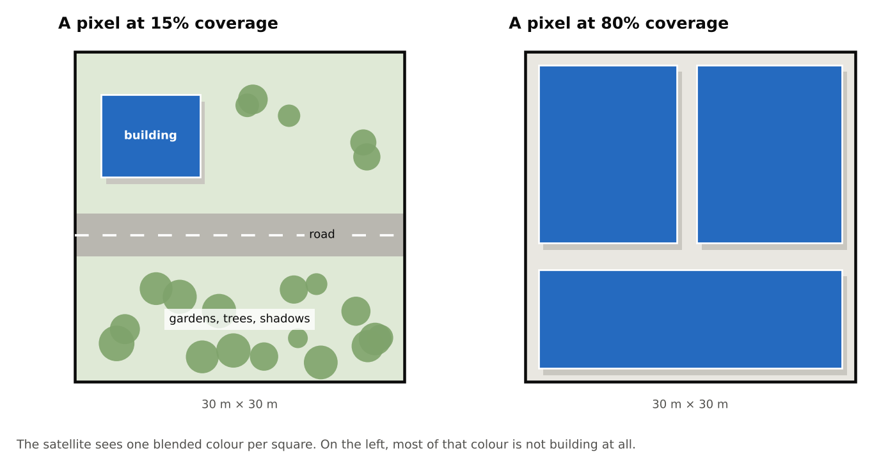

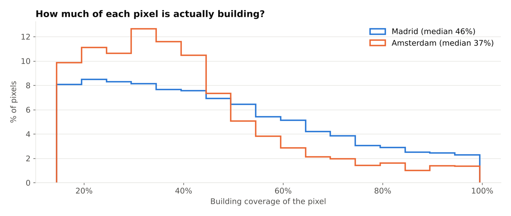

The satellite record also only starts in 1984. Classes 1 and 2 were built before that, so the satellite never sees them being built. For newer buildings you can sometimes see greenness (NDVI) drop in the year construction happens, but in dry Madrid the drop is small.

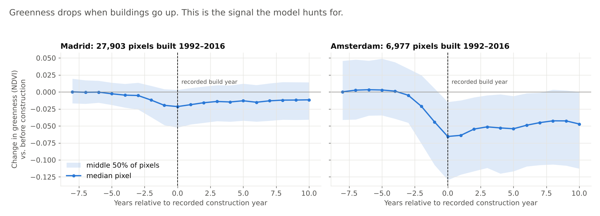

Lastly, the class boundaries are different in each city. A 1950 building is Class 1 in Madrid and Class 2 in Amsterdam. About 9.9% of Amsterdam falls in that 1945 to 1960 gap, and we measured that it costs around 0.029 of zero-shot F1.

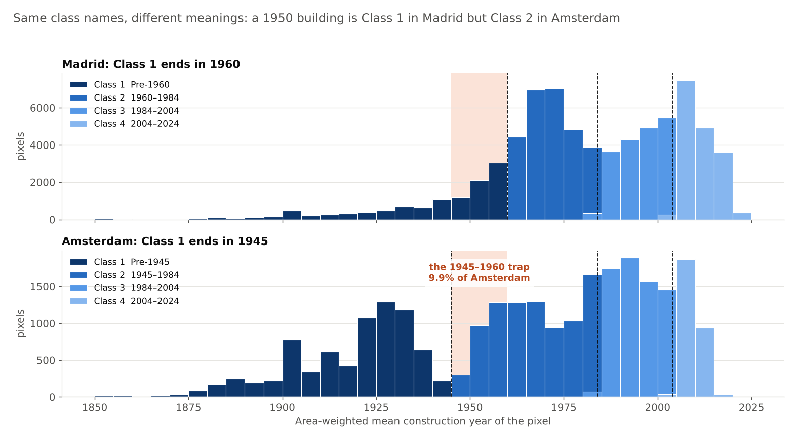

## 3. The data

There are two parquet files, one per city. Each row is one pixel in one year (1984 to 2025) and holds up to three satellite snapshots from that year. Each snapshot has six colour bands (Blue, Green, Red, NIR, SWIR1, SWIR2) and a flag that says whether it was cloud free. Each pixel also has a `coverage` value and a `weighted_mean_year`, which is the target we cut into classes.

| File | Size | Pixels |
|---|---:|---:|
| `madrid_train.parquet` | ~142 MB | 76,263 |
| `amsterdam_data.parquet` | ~44 MB | 25,992 |

The files are too big for GitHub, so they are not in this repo. See [`data/README.md`](data/README.md) for how to get them.

## 4. Our approach

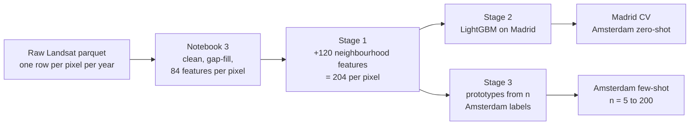

Notebook 3 turns each pixel's 40-year history into one row. It picks the best clean snapshot per year, fills missing years by interpolation and adds five spectral indices (NDVI, NDBI, UI, MNDWI, BSI). It then summarises the history into the 60 features from the provided baseline. We added 24 more. These are 12 contrast features (late period minus early period for each band), 11 trend slopes over time, and the pixel's building coverage. That gives 84 features per pixel.

Notebook 4 adds 120 neighbourhood features (section 5), trains a LightGBM classifier on Madrid and transfers to Amsterdam (section 7). In an earlier test on our checkpoint setup, the neighbourhood features added +0.0691 F1 while swapping Random Forest for LightGBM added +0.0074, so most of our time went into features.

## 5. Finding neighbours with a KD-tree

Buildings in a city are usually built in groups, like a housing estate or a row of flats from the same decade. That means the pixels around a building say a lot about its age. We used this by giving every pixel a summary of its nearest building pixels, which became the most important part of our model (71% of the model's feature importance).

The hard part is the neighbour search. Madrid has 76,263 pixels. Comparing every pixel with every other pixel is about 5.8 billion distance calculations, and it has to be repeated for every fold of cross-validation. So instead of a brute force search we used a KD-tree (`scipy.spatial.cKDTree`).

### How a KD-tree works

A KD-tree is a binary tree that splits space into boxes. Our points are 2D, the pixel's position on the 30 m grid. The first level splits all the points in half with a vertical line at the median x value. Each half is then split with a horizontal line at its median y value. The splits keep alternating between x and y until each box only holds a few points.

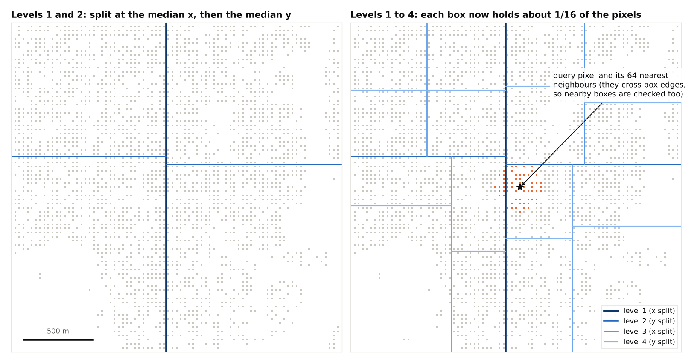

To find the k nearest neighbours of a pixel, the search goes down the tree to the box that holds the pixel. It then checks the boxes around it and skips any box that is further away than the current k-th closest point. Most of the city never gets looked at. Building the tree takes O(n log n) time, and each query takes about O(log n + k) instead of O(n) for brute force.

### What we compute

For each pixel we take its 16, 64, 256, 1,024 and 2,048 nearest building pixels. On the Madrid grid these reach roughly 80 m, 170 m, 360 m, 750 m and 1.1 km. For each of these five rings we compute the mean and standard deviation of 12 spectral features (`NIR_mean`, `Red_mean`, `SWIR1_mean`, `NDVI_mean`, `NDBI_mean`, `MNDWI_mean`, `NIR_std`, `Red_std`, `NIR_early_mean`, `Red_late_std`, `SWIR1_late_std`, `d_NIR_mean`). That is 12 × 5 × 2 = 120 new features, giving 204 in total.

<p align="center">
  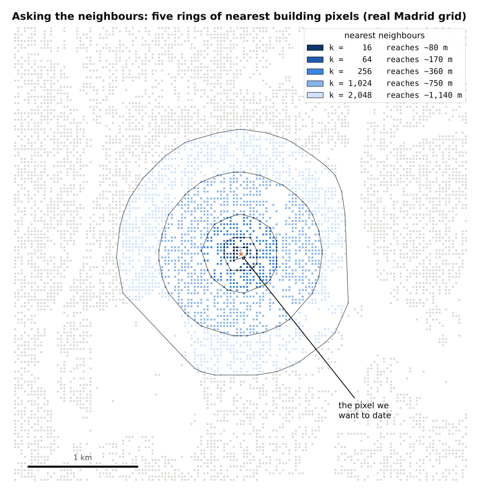
</p>

We only average spectral values. Labels, construction year and coverage are never averaged, because then the model would be reading its neighbours' answers.

### Computing all five scales at once

The KD-tree returns neighbours sorted by distance, so the nearest 16 are just the first 16 of the nearest 2,048. We query once at k = 2,048 and take running sums of the values and their squares along the neighbour axis. The mean and standard deviation for any k then come straight from the prefix sums:

$$\mu_k = \frac{S_k}{k}, \qquad \sigma_k = \sqrt{\frac{Q_k}{k} - \mu_k^2}$$

where $S_k$ is the sum of the first k values and $Q_k$ is the sum of their squares. This turns five tree queries into one, which made the full run roughly five times faster.

Holding 2,048 neighbours × 12 features for every pixel at once does not fit in memory, so the queries run in batches sized to keep each batch near 250 MB. The queries also run on all CPU cores (`workers=-1`).

```python
tree = cKDTree(reference_xy)                       # build once per fold
for start in range(0, n_query, batch):
    _, idx = tree.query(query_xy[start:start+batch], k=2048, workers=-1)
    vals  = reference_values[idx]                  # (batch, 2048, 12)
    csum  = np.cumsum(vals, axis=1)                # running sums
    csum2 = np.cumsum(vals ** 2, axis=1)           # running sums of squares
    for k in (16, 64, 256, 1024, 2048):
        mean = csum[:, k-1] / k
        std  = np.sqrt(np.maximum(csum2[:, k-1] / k - mean ** 2, 0))
```

### Query set and reference set

The function takes two sets of pixels. The query set is the pixels we want features for, and the reference set is where the neighbours come from. During cross-validation the reference set is only the training fold, so a validation pixel never gets features from other validation pixels. When a pixel is part of its own reference set, its nearest neighbour is itself, so we drop that first result. In Amsterdam the reference set is all Amsterdam pixels. This needs no labels, only pixel positions and colours, which would be available in any new city.

### Choosing the scales

We also tested k = 4,096. Madrid improved by only 0.0008, which is inside the fold noise, while Amsterdam dropped by 0.0011. At that size the neighbourhood is close to the average of the whole city, so the feature starts describing the city instead of the pixel. We stopped at 2,048. Each of the five scales ended up with a similar share of feature importance (13.6% to 14.9%), so none of them is wasted.

## 6. Testing without leakage

A normal random train/test split does not work here. Neighbouring pixels share buildings and now also share neighbourhood features, so a random split puts almost identical pixels on both sides and inflates the score.

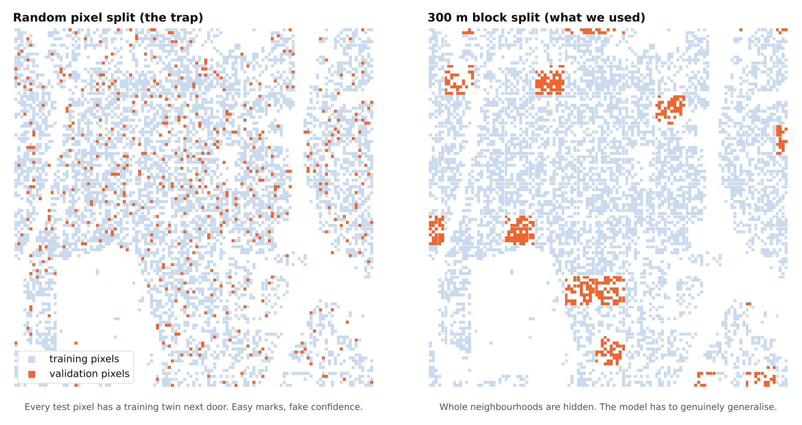

We split Madrid into 3,124 blocks of 300 m × 300 m and held out whole blocks with `GroupKFold`, combined with the fold-safe neighbourhood features from section 5. This is a stricter test than the baseline used, and our score still went up, which is good evidence that the gain is real.

## 7. Transfer to Amsterdam

With 25 labels per class there are only 100 labelled pixels, which is too few to retrain a model without it memorising them. Instead we use prototypes. For each class we average the features of its labelled Amsterdam pixels to get a prototype, then give every other pixel the class of its nearest prototype (Euclidean distance over the 204 features).

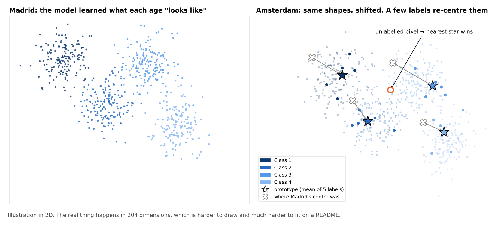

This step does not use the LightGBM model at all, only the features. That is why improving the features improved the Amsterdam scores. Each label budget was run 10 times with different random labelled pixels, and those pixels were left out of scoring.

## 8. Results

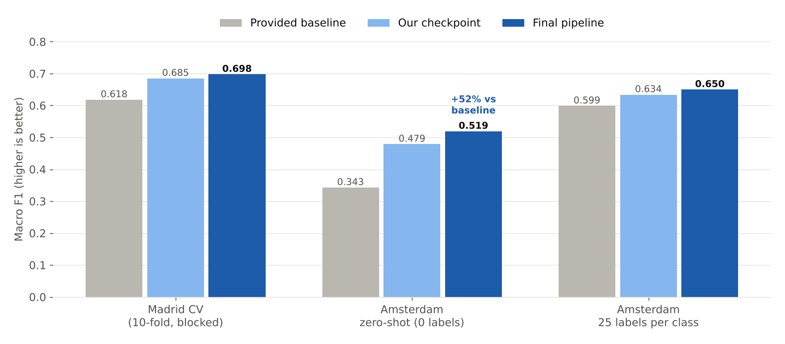

| Labels per class | Provided baseline | Our checkpoint | Final (mean ± std, 10 runs) |
|---:|---:|---:|---:|
| 0 (zero-shot) | 0.3427 | 0.4787 | **0.5192** |
| 5 | 0.5437 | 0.5764 | **0.6080 ± 0.0301** |
| 10 | 0.5649 | 0.5955 | **0.6143 ± 0.0248** |
| 25 | 0.5986 | 0.6340 | **0.6499 ± 0.0109** |
| 50 | 0.6079 | 0.6415 | **0.6578 ± 0.0071** |
| 100 | 0.6129 | 0.6479 | **0.6635 ± 0.0060** |
| 200 | 0.6150 | 0.6470 | **0.6633 ± 0.0037** |

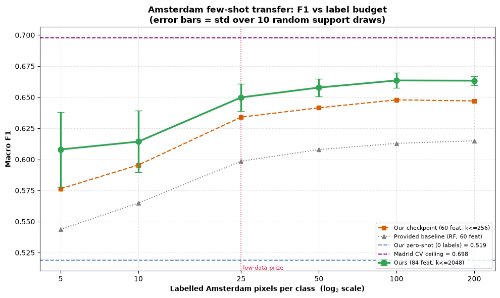

We beat the baseline at every label budget. Five labels per class already close most of the gap to the Madrid score, and the curve flattens after 100. This suggests the main difference between the cities is where each class sits, not what separates the classes. Most of the remaining errors are between neighbouring classes, like a 1983 building and a 1985 building.

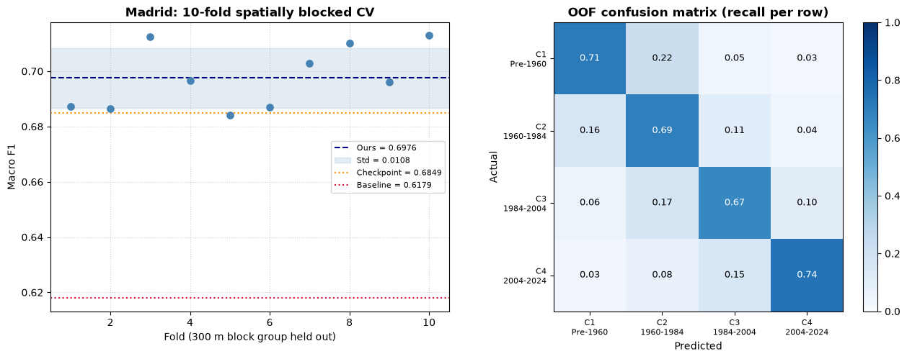

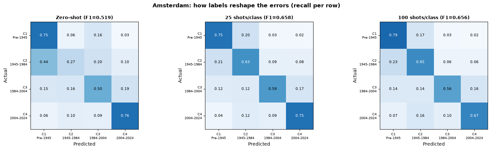

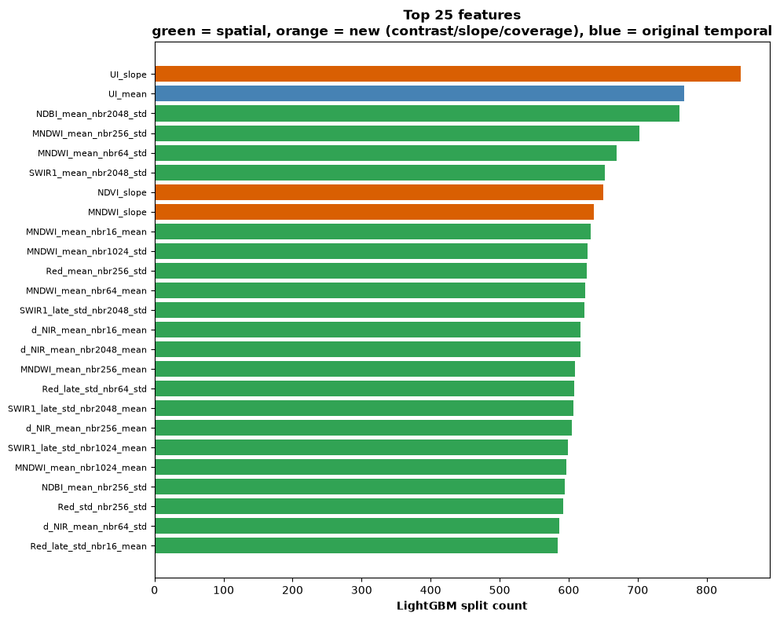

## 9. What did not work

| Idea | Result |
|---|---|
| Switching between Random Forest, LightGBM and CatBoost on the original features | All within noise of each other |
| SAVI index | Became exactly 1.5 × NDVI because our data is scaled to about 10,000, not 0 to 1 |
| Construction breakpoint detection | Ran after gap-filling, so the interpolation had already smoothed out the jumps |
| Coverage as a sample weight | +0.0006, compared with +0.0024 as a feature |
| Fixed-radius neighbourhoods instead of k-nearest | −0.0144 on Madrid |
| Predicting the year directly, then binning per city | Biased by −16.4 years on Amsterdam |

## 10. Limitations and next steps

Confusion between neighbouring classes is partly unavoidable, since labels are averages over mixed buildings and classes 1 and 2 predate the satellite record. The class 1/2 boundary also differs between cities. The scaler is fit on all of Madrid before cross-validation, and the setup was chosen on the same CV that reports it, so the headline may be slightly optimistic (around 0.005).

The next step we would try is predicting the construction year instead of the class, then cutting it with each city's own boundaries. Other ideas are smoothing predictions across space, choosing which pixels to label instead of picking them at random, and selecting the 12 neighbourhood source features systematically.

## 11. Repo structure

```text
BuildingClassifier/
├── README.md
├── requirements.txt
├── 3Notebook_Processing.ipynb    parquet → 84 features → preprocessed_v2.pkl
├── 4Notebook_Modelling.ipynb     neighbourhoods, CV, LightGBM, Amsterdam transfer
├── baseline_problem/             original notebooks from the organisers
├── data/                         data files go here (ignored by git), see data/README.md
├── scripts/fetch_data.py         downloads and checks the data
├── models/                       trained model is saved here (ignored by git)
└── docs/
    ├── images/                   pictures used in this README
    └── make_figures.py           regenerates the README pictures
```

If you are new to the project, read `baseline_problem/1-Introduction.ipynb` for the original challenge, then Notebook 3 and Notebook 4. Our changes in Notebook 3 are marked with **CHANGE** headings.

## 12. How to run

```bash
git clone https://github.com/definitelynotironman/BuildingClassifier.git
cd BuildingClassifier
pip install -r requirements.txt
python scripts/fetch_data.py
jupyter lab
```

Run `3Notebook_Processing.ipynb` first. It creates `data/preprocessed/preprocessed_v2.pkl`. Then run `4Notebook_Modelling.ipynb`, which saves the model to `models/` and writes the results CSVs. The 10-fold CV took us about 40 minutes and can take 2 to 3 hours on a slower machine. Set `N_SPLITS = 5` at the top of Notebook 4 for a faster run. Everything is seeded, so the numbers should match ours.

## 13. Team and credits

Built by **Group 3** at the **StatsGeeks × Hack4Dev hackathon**, September 2026:

**Keera · Albert · Sima · Fulu**

- The challenge, the baseline notebooks in `baseline_problem/` and the datasets were provided by the hackathon organisers.
- Satellite data: Landsat 5, 7, 8 and 9, courtesy of NASA and the U.S. Geological Survey.
- Repo maintained by [@definitelynotironman](https://github.com/definitelynotironman).
